# Pizza
Pizza is an Italian dish typically consisting of a flat base of leavened wheat-based dough topped with tomato, cheese, and other ingredients, baked at a high temperature, traditionally in a wood-fired oven.

Pizza and its variants are among the most popular foods in the world. Pizza is sold at a variety of restaurants, including pizzerias, Mediterranean restaurants, via delivery, and as street food. In Italy, pizza served in a restaurant is presented unsliced, and is eaten with the use of a knife and fork. In casual settings, however, it is typically cut into slices to be eaten while held in the hand. Pizza is also sold in grocery stores in a variety of forms, including frozen or as kits for self-assembly. Store-bought pizzas are then cooked using a home oven.

## Preparation
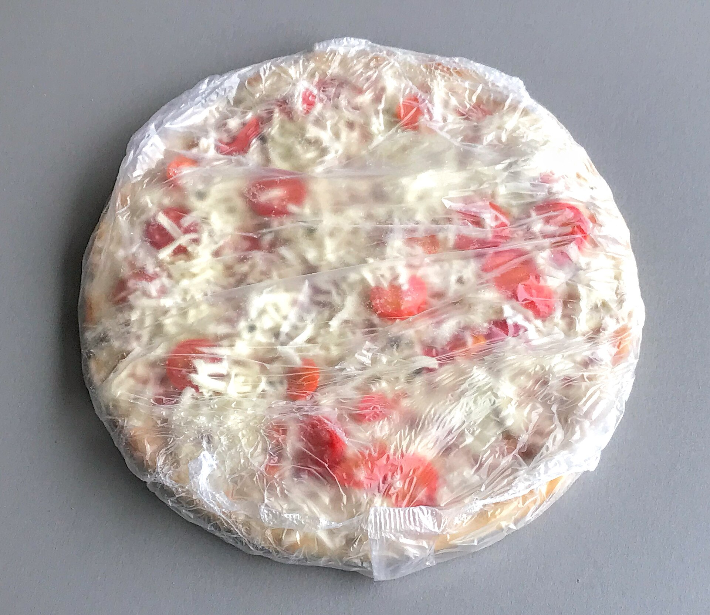
Pizza is sold fresh or frozen, whole or in portion-size slices. Methods have been developed to overcome challenges such as preventing the sauce from combining with the dough, and producing a crust that can be frozen and reheated without becoming rigid. There are frozen pizzas with raw ingredients and self-rising crusts.

## Varieties and styles
**Italian varieties**
|Image|Name|Characteristic ingredients|Origin|
|---|---|---|---|
|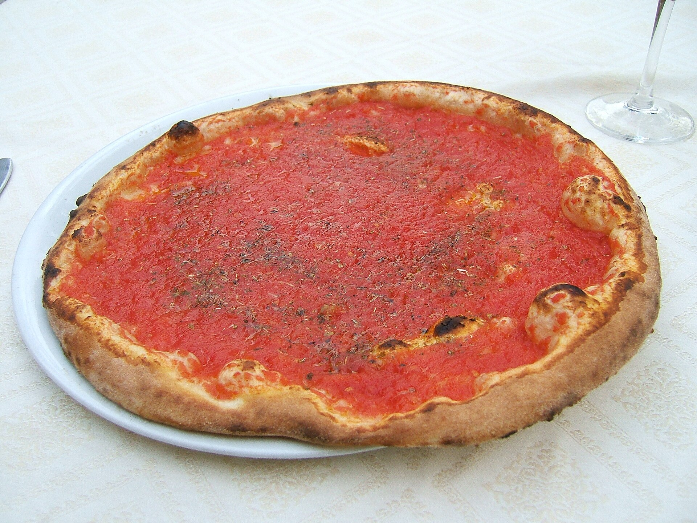|Pizza Marinara|Tomato sauce, olive oil, oregano, garlic. No cheese.|Naples, Italy|
|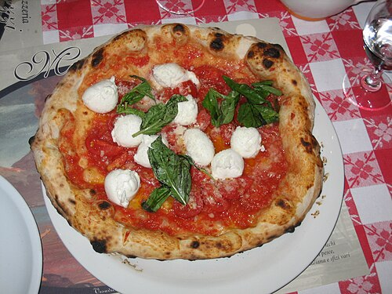|Pizza Margherita|Tomatoes, mozzarella, basil.|Naples, Italy|
|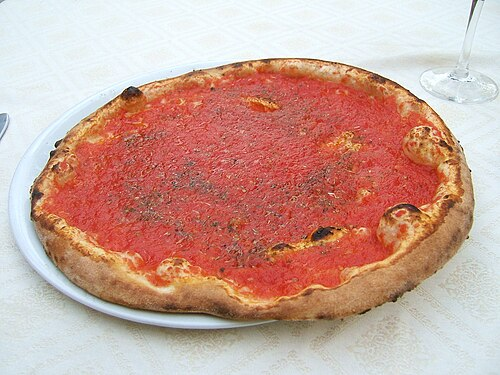|Pizza capricciosa|Ham, mushrooms, artichokes, olives, tomatoes.|Rome, Lazio, Italy|

**Italian styles**
|Image|Name|Characteristic|Origin|
|---|---|---|---|
|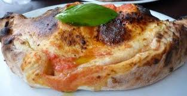|Calzone|Pizza folded in half turnover-style, baked.|Naples, Italy|
|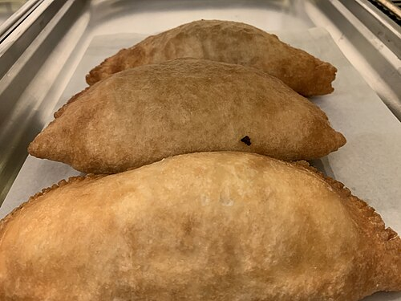|Panzerotti|Similar to a calzone, but fried.| Apulia, Italy|
|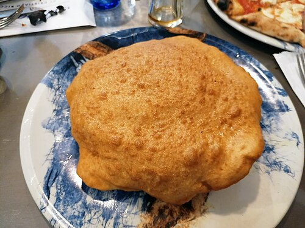|Deep fried pizza (*pizza fritta*)|The pizza is deep fried (cooked in oil) instead of baked.|Naples, Italy|
|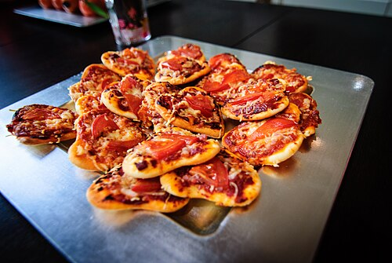|Pizzetta|Small pizza served as an hors d'oeuvre or snack.|Italy

**North American styles**
|Image|Name|Characteristic|Origin|
|---|---|---|---|
|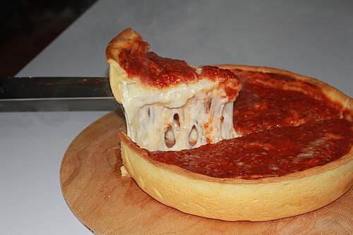|Chicago-style pizza|Baked in a pan with a high edge that holds in a thick layer of toppings. The crust is sometimes stuffed with cheese or other ingredients.|Chicago, US|
|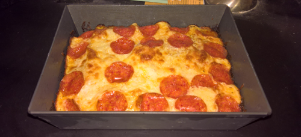|Detroit-style pizza|The cheese is spread to the edges and caramelizes against the high-sided heavyweight rectangular pan, giving the crust a lacy, crispy edge.|Detroit, US|
|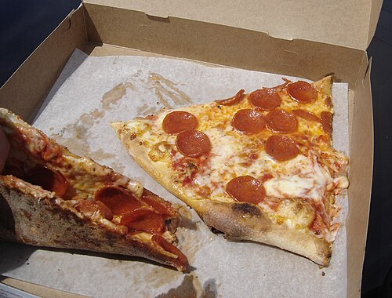|New York–style pizza|Neapolitan-derived pizza with a characteristic thin foldable crust.|New York metropolitan area (and beyond)|

## Similar dishes
- Calzone and stromboli are similar dishes that are often made of pizza dough folded (calzone) or rolled (stromboli) around a filling.
- Coca is a similar dish consumed mainly in Catalonia and neighboring regions, but that has extended to other areas in Spain, and to Algeria. There are sweet and savory versions.
- Farinata or cecina is a Ligurian (farinata) and Tuscan (cecina) regional dish. It is often baked in a brick oven, and typically weighed and sold by the slice.
Flammekueche is a food speciality of the Alsace region.
- Focaccia is a flat leavened oven-baked Italian bread, similar in style and texture to pizza; in some places, it is called pizza bianca (lit. 'white pizza').
Garlic fingers is an Atlantic Canadian dish, similar to a pizza in shape and size, and made with similar dough. It is garnished with melted butter, garlic, cheese, and sometimes bacon.
- Semsek is an Armenian dish made with dough thats shaped into a circle with braided edges. It is topped with a mixture of seasoned mixture of minced meat and puréed roasted vegetables such as tomatoes and peppers